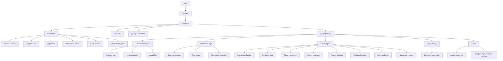
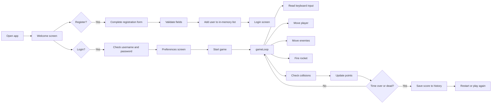

# SpaceShipGame Architecture

This project is a browser-based arcade shooter built with plain HTML, CSS, and JavaScript. It does not use a backend server or database; the game state and user data are stored in memory inside the browser.

## High-level architecture

## Game flow

## Main project structure

- `index.html` — main browser page and UI sections
- `js_files/game.js` — all game behavior, registration, login, preferences, and gameplay logic
- `css_files/` — styling for the screens and game interface
- `audio/` — background music and sound assets
- `media/` — images used by the game

## Runtime behavior

1. The user loads the website in the browser.
2. The browser renders the page using HTML and CSS.
3. `game.js` attaches events for login, registration, menu navigation, and gameplay.
4. User input is handled via keyboard and form events.
5. The canvas-based game loop updates objects and checks collisions every frame.
6. The score history is shown in a table in the browser and is stored temporarily in JavaScript variables.

## Notes for future improvement

This project is a strong candidate for a future Git repository refactor because the visual structure is already organized, and the next steps could be:

- separate logic into modules,
- add real backend persistence,
- create a cleaner landing page and game dashboard,
- improve game UI/UX with modern styling.

## Suggested next Git step

When you create the new repository, keep the project as a front-end game and add documentation like this file to make it easier to present and maintain.
